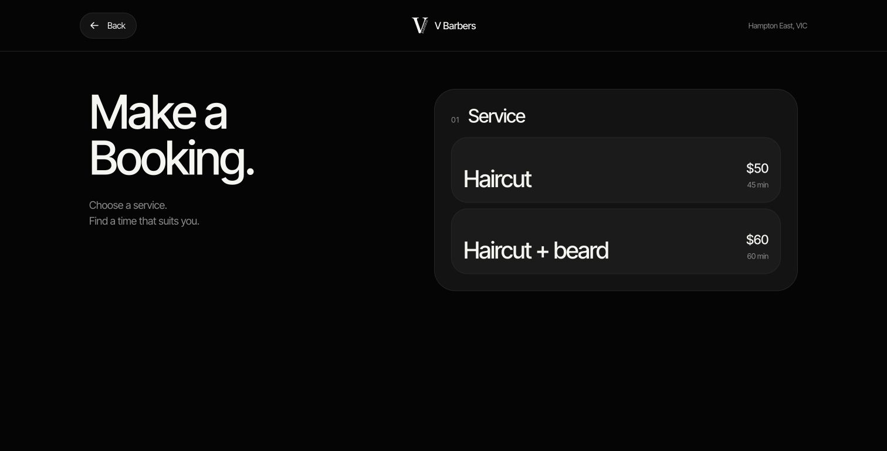

# Approved design release — 27 October 2026

Vance approved the review design and the user explicitly requested publication
to the Peregrine Office subdomain. The blue logo preface and bottom-up page
transitions are now live at https://vbarbers.peregrineoffice.space/.

## Deployment

- Production Worker: `vbarbers`.
- Source branch/commit: `cloudflare` / `c8b0030`.
- Active production version: `ae9be431-51d7-4369-94b4-f92bc766b855` at 100%.
- Previous version: `e3bf1873-900f-481a-b7c6-d0175f72be5f`.
- Both Office and the older Partners booking address serve the new release.
- Built and deployed from the main project using its production Wrangler
  configuration. The isolated review copy and its patch were not used.
- Supabase store, existing service-key secret, Cloudflare email binding and
  Office `SITE_URL` are preserved. Production has no review-only submission
  guard or snapshotted schedule.
- No application code changed during publication, and no database migration,
  real appointment or email send was needed for the release checks.

## Published behavior

Blue preface with the black mark for 600 ms, then the full landing page rises
from below over 600 ms. Original rounded booking controls remain. Booking
also rises full-screen (420 ms), with Back/Escape reversing it (320 ms).
The intro remains skippable and once per tab session, with reduced-motion
handling. Open a fresh tab to replay the preface. Clipper removal remains live.

## Release checks

- 61 automated tests passed.
- Cloudflare production build, Next route types, TypeScript and deployment
  dry run passed.
- Generated config asserted the live Worker, Office route, Supabase store
  and EMAIL binding; no review snapshot or booking-blocking preview guard.
- Public homepage, CSS and JavaScript returned HTTP 200, including the new
  intro and page-slide styles.
- Public availability returned HTTP 200 with no-store.
- An empty booking POST returned normal HTTP 400 validation rather than the
  review copy's HTTP 403. It did not create an appointment.
- `/owner` returned HTTP 307 to the Office shop diary.
- The older Partners booking address returned HTTP 200.
- Cloudflare API confirmed the new version at 100% and the expected store,
  Office URL, service-key secret and email binding.
- Browser verified intro completion, booking open, service/date interaction
  and Back. The design's desktop/mobile and Escape/focus behavior had also
  been checked during the approved preview.

The live owner sign-in and inbox-delivery acceptance cycle in the
[25 October audit](booking-readiness-audit-2026-10-25.md) remains a separate
operational follow-up. This release did not send a real test booking or claim
that Vance's device/email acceptance checks were completed.

## Review copy

https://vbarbers-design-review-20261026.peregrine-office.workers.dev/ remains
available as a separate review-only copy; it still cannot submit bookings.
Its recovery files are in `docs/previews/2026-10-26/`. Production does not use
those overrides. The [26 October session handoff](session-handoff-2026-10-26.md)
is historical context; its pending-design-publication instruction is superseded
by this approved release.
